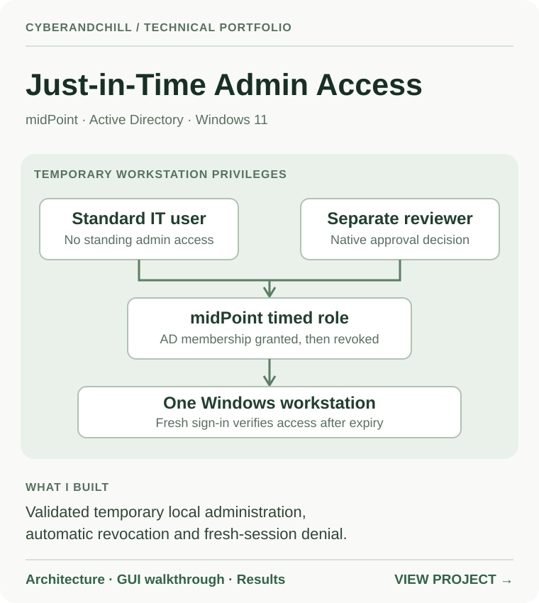

# CyberAndChill

### Identity Engineering · Infrastructure · Security

**Enterprise IT projects, built and validated.**

A curated portfolio of identity and security systems, with the architecture, test evidence and documentation behind each build.

[Explore projects](#selected-projects) · [How the portfolio works](#behind-each-project) · [X](https://x.com/cyberandchill) · [Website](https://cyberandchill.com)

---

## Selected projects

Each architecture card opens a project with a technical summary, a reproducible guide and supporting evidence.

| Featured build | Featured build |
|:---:|:---:|
|  |  |
|  |  |
|  |  |

## Behind each project

| Architecture | Implementation | Evidence |
|:---|:---|:---|
| A clear picture of the systems and identity flow | What was configured and why it matters | Screenshots, tests, results and troubleshooting notes |

**Open a card** to explore the project. Implementation guides are linked from each project page. All evidence reflects recorded lab work; nothing here is a claim about a live production environment.

---

CyberAndChill · [Technical portfolio guide](docs/START-HERE.md) · [GitHub](https://github.com/cyberandchill)
