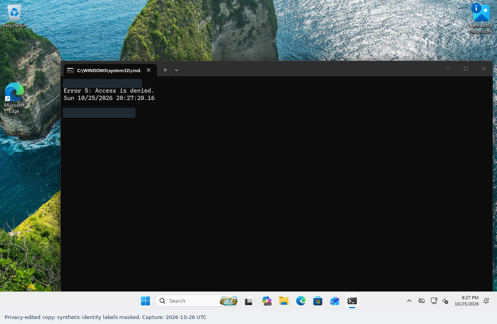
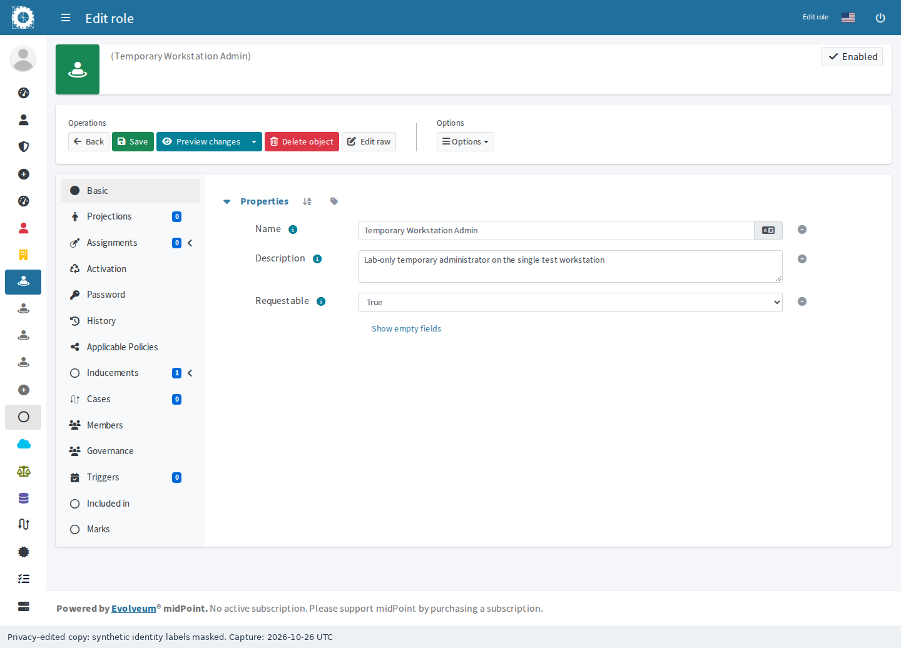
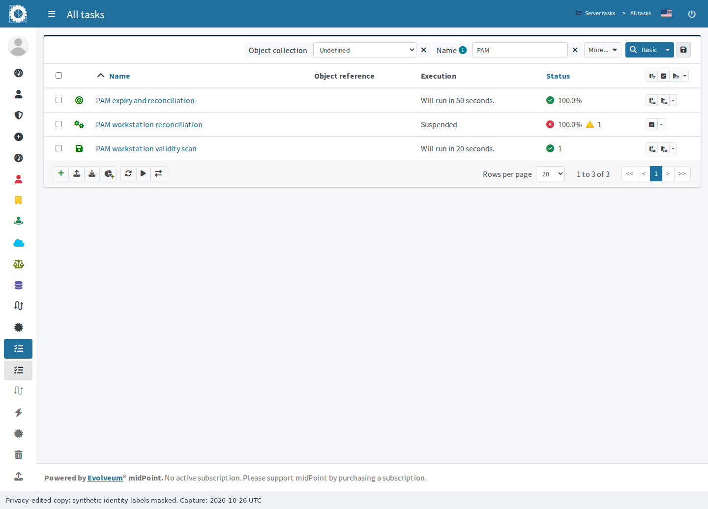
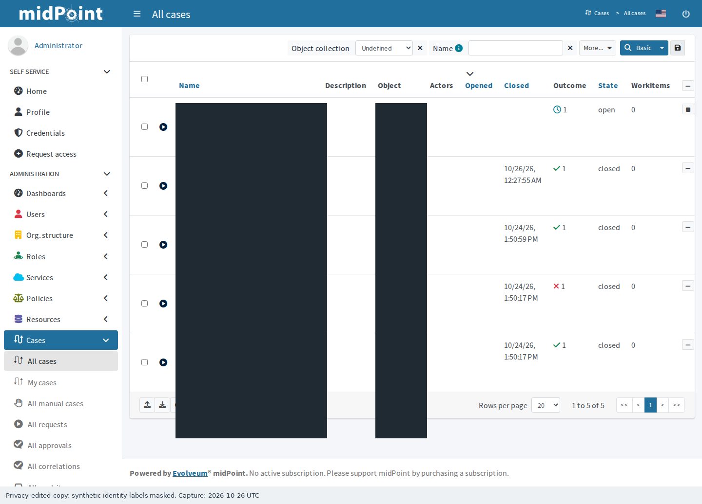
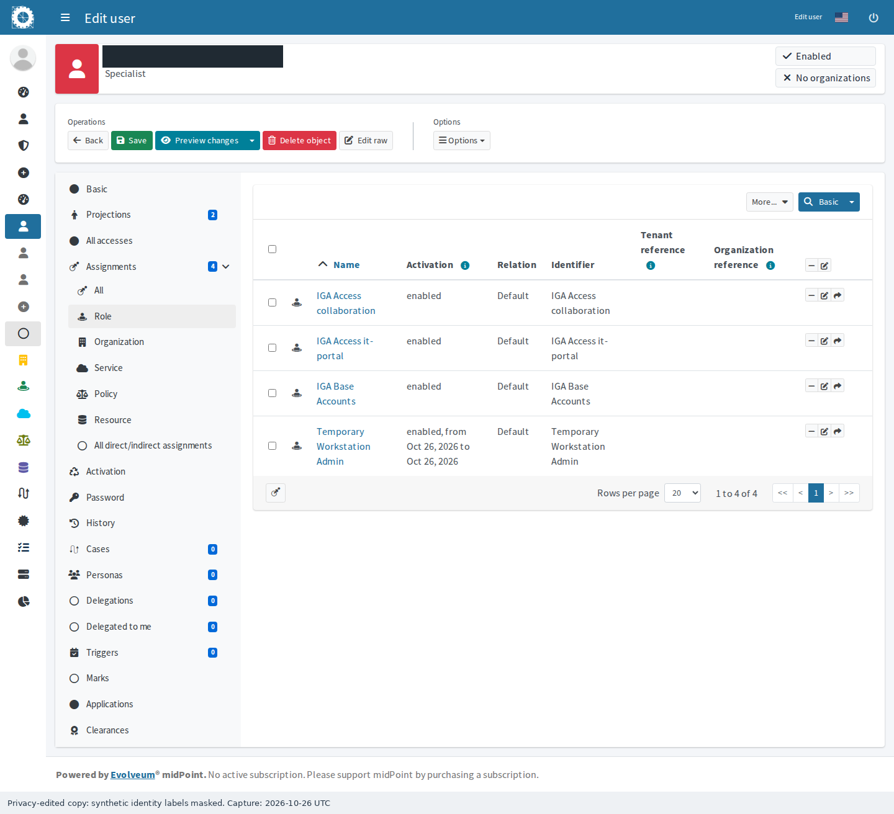
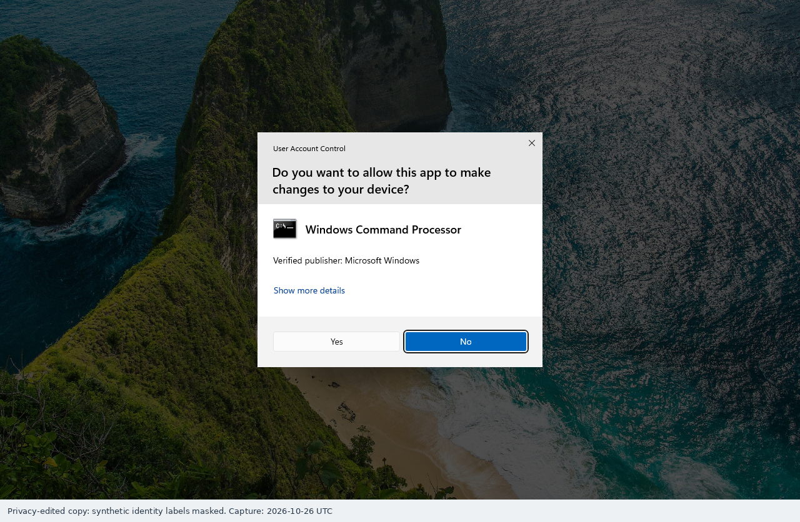
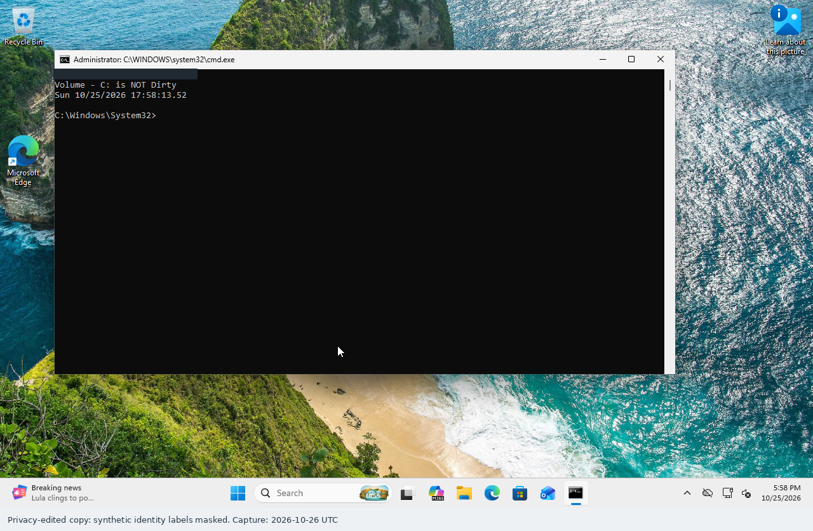
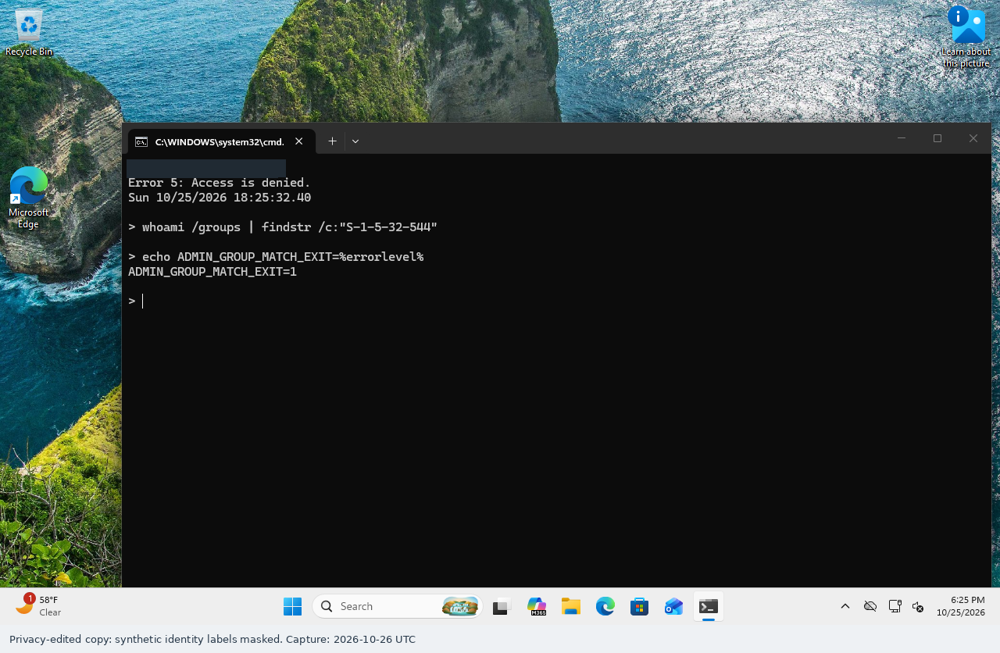

# Just-in-Time Workstation Administration — Setup Guide

**Goal:** See a standard IT user denied administrator access, receive temporary access through midPoint, lose AD membership automatically, and be denied administrator access after a fresh Windows sign-in.

**Evidence scope:** The initial standard-user denial screenshot comes from the first trial. The pending case, active role, scheduled tasks and allowed/expired Windows outcomes document the corrected full-length trial. The first failed expiry is disclosed in the reference and is not counted as a pass.

**Procedure status:** Configuration used supported native APIs and conventional Windows administration. Browser navigation and Windows console tests were automated GUI interactions. The equivalent configuration instructions below are derived from that configuration; a complete independent manual rebuild was not replayed. Approval was an automated test using a separate reviewer account, not a human review session.

## Prerequisites

- Complete the existing AD and midPoint integration first. Use an isolated AD domain, a joined Windows 11 **Pro** test workstation, and an existing synthetic standard IT user already managed by midPoint.
- Recorded software: midPoint 4.10.5 with its existing native repository, Windows Server 2022 AD, and Windows 11 Pro build 26300.9711. Retain the existing connector, trusted LDAPS certificate and accounts; no additional PAM product is needed.
- The connector must manage only owned lab users/groups and successfully provision **and revoke** native AD group associations. Preserve other application groups and synchronization scope.
- Use an authorized midPoint setup administrator, a distinct configured access reviewer, directory permission for the lab Groups OU, and local administrator access to the **one** test workstation. Preserve independent administrator access.
- All three systems must communicate, resolve AD DNS and keep accurate time. Expiration is not enforceable while required services are unavailable. Use your existing isolated network and sufficient resources.
- Examples use `ad.lab.example.com`, `LAB`, `it-test`, `WS-TEST`, and `PAM-Workstation-Admins`. They are documentation examples. Substitute only your owned lab objects.

## Step 1 — Confirm the starting state

1. In midPoint, open **Resources → All resources → your AD resource → Test connection**. Confirm success, then inspect the user's **Projections** and actual AD memberships.
2. On the directory server, open **Server Manager → Tools → Active Directory Users and Computers**. Open the synthetic user → **Member Of**; verify there is no administrative group membership.
3. On Windows, open **Computer Management → System Tools → Local Users and Groups → Groups → Administrators**. Record existing members and preserve them.
4. Sign in as the standard test user. Open **Start → Command Prompt**, run `whoami` and `fsutil dirty query C:`. This query reads the guest volume status and does not modify it.

*Actual Windows console, October 26 UTC capture time. Identity fields are masked; the administrator-only query returned Error 5, Access denied.*

**Expected result and verification:** The intended user is signed in and the query is denied. A connection-test success alone does not demonstrate privilege separation.

## Step 2 — Scope the administrator group to one workstation

1. In **Active Directory Users and Computers**, inspect the dedicated lab **Groups** OU. Create a **Global / Security** group named `PAM-Workstation-Admins`, or let the midPoint group projection in Step 3 create it. Do not create a second group with the same purpose.
2. Open the group's **Members** tab and confirm it is empty. Record its DN and SID. It must not be nested into Domain Admins, another privileged domain group, or a group deployed to multiple computers.
3. On **WS-TEST only**, sign in with the independent administrator. Open **Computer Management → Local Users and Groups → Groups → Administrators → Add**.
4. Set **Locations** to the lab domain, enter `PAM-Workstation-Admins`, select **Check Names → OK → Apply**. Leave all existing members in place.
5. Reopen **Administrators** and confirm exactly the intended group was added. Check that no broad Group Policy or other computer uses this newly dedicated group.

**Expected result and verification:** Membership in this domain group confers local administrator access on the single workstation. An empty group grants the test user nothing. The conventional CLI alternative is the standard `Add-LocalGroupMember` cmdlet in the [reference](REFERENCE.md); it is not an expiration script.

## Step 3 — Map the group to a native midPoint role

1. In **Roles → All roles**, inspect existing entitlement roles and their **Projections**. Reuse the proven AD association design from the integration guide.
2. Create an owned group role whose **Assignments → Resource** construction targets the existing AD resource with **kind: entitlement / intent: group**. Use constant outbound values for the group's DN, CN, sAMAccountName and global-security groupType. The reference provides an XML example for **Configuration → Import object** when the detailed mapping editor is impractical.
3. If the group already exists, find it through **Resources → AD resource → Accounts / Entitlements → group**, inspect the exact DN/SID, and link it to the group role's projection. If midPoint creates it, verify that the role receives the correct projection. Do not duplicate the AD group.
4. Create **Temporary Workstation Admin**, set **Requestable: True**, then **Inducements → Role → Add** the group role. The existing resource-level native associationFromLink mapping must derive user membership from that role.
5. Inspect the role and its projection path. Do not assign the group-construction role directly to the test user or add Keycloak/application entitlements to the PAM role.

*Authentic midPoint role configuration from the working lab; this is resulting state, not proof that configuration was manually entered.*

**Expected result and verification:** The access role induces one owned AD group through the established native association. The target user still has no PAM membership before approval.

## Step 4 — Configure approval and scheduled processing

1. Open **Configuration → Repository objects → System configuration**. Preserve existing policy rules. Add a separate assignment approval rule scoped to **this PAM role and this test user only**, with **evaluationTarget: assignment**, operation **add**, and the existing reviewer. Set **outcomeIfNoApprovers: reject**. Use the reference example when raw XML editing is needed.
2. Keep reviewer and requester identities separate. Do not expand an existing provisioning service's role catalog to include PAM simply to make the demonstration work. In this lab, the setup administrator initiated the request; the separate reviewer completed it.
3. Open **Server tasks → All tasks → New task**. Create a **Validity scanner** for the exact test user, **Runnable**, **interval 30 seconds**. The reference gives a native task XML import alternative and exact query scope.
4. Create the native **PAM expiry and reconciliation** task from the [reference](REFERENCE.md#expired-assignment-processing-and-the-failed-first-trial), scoped to that same user, **interval 60 seconds**. Its built-in **unassign** action selects only the PAM role assignment with **effectiveStatus: disabled**, then native **recompute / reconcile** checks target state. Do not omit the role/status filters or add an external removal script. The initial recomputation-only task did not remove the expired membership and was replaced.
5. Open each task and verify the target query, schedule, successful run and last completion time. Preserve the existing global scanner interval. Confirm which schedule actually removes the AD membership during the test.

*Authentic native task list. The active validity and expiry/reconciliation tasks are separate from the existing global scanner. The obsolete recomputation-only trial is retained suspended with its failed result.*

**Expected result and verification:** Both user-scoped tasks run successfully. Thirty seconds is a configured processing cadence, not a guarantee of exact removal latency. Task queues, failures and directory availability can increase delay.

## Step 5 — Request the 15-minute window and approve it

1. Open **Users → All users → it-test → Assignments → Role → Assign** and select **Temporary Workstation Admin**.
2. Open the new assignment's **Edit / Activation** controls. Set **Valid from** to the intended start and **Valid to** exactly 15 minutes later, using explicit time and timezone. Save the user. The XML equivalent is shown in the reference.
3. Open **Cases → All cases / All approvals**. Confirm a pending case, the correct role, exact validity window and distinct reviewer. In AD, confirm the user is still absent from the PAM group.
4. The authorized reviewer opens the work item, checks scope/expiry and chooses **Approve**. Do not claim native approval if your deployment grants immediately or lacks the configured policy; use an explicitly authorized assignment and disclose that difference.
5. Refresh the native user assignment and the actual AD group. Record request, decision and first observed target-membership timestamps. Wait for asynchronous execution instead of submitting the request again.

*Authentic midPoint case and assignment views. Approval consumes part of the fixed 15-minute window; the recorded test did not promise 15 full minutes after approval.*

**Expected result and verification:** Membership is absent while pending and appears only after the separate reviewer decision. In the recorded test, an unauthorized service's decision attempt returned 403 and the reviewer's decision returned 204. Target provisioning completed asynchronously.

## Step 6 — Verify temporary administrator access

1. On Windows, **Start → account icon → Sign out**. Signing out is required; locking/unlocking does not create a fresh user token.
2. Sign in again as **the same test user** while AD is reachable. Press **Win+R**, enter `cmd`, then press **Ctrl+Shift+Enter**.
3. Verify that UAC offers **Yes / No** consent for the user. Choose **Yes**. Do not enter a different administrator's credentials; that would test another identity.
4. Run `whoami`, `fsutil dirty query C:`, and `echo %date% %time%`. Record the result and leave this elevated window open for the old-token test.

*The same user ran the read-only query in an elevated Command Prompt. UAC remained enabled.*

**Expected result and verification:** The query succeeds under the synthetic user, demonstrating effective local administration rather than merely group membership.

## Step 7 — Observe expiration and test a fresh sign-in

1. Leave midPoint, the scheduled tasks and AD running. Wait beyond **Valid to**; do not manually remove the membership or click Recompute to create the claimed automatic result.
2. Refresh the actual AD group and the user's assignment. Record the last observed membership, first observed absence, task completion timestamps and any failure. The scanner first marks the assignment disabled; the final native expiry task then deletes only that expired PAM assignment. Record the two stages separately.
3. In the **already-open elevated window**, repeat the read-only query. Record whether the old token still permits access. Directory revocation does not itself terminate that process or Windows session.
4. Sign out fully, then sign in again as the same user while the domain is reachable. Inspect `whoami /groups` for Administrators membership as well as testing the operation: an ordinary unelevated query can be denied even while elevation is still possible. In the recorded lab, sign-out alone retained stale group information; restart the test client, wait for domain/time synchronization and then sign in online. Open an ordinary Command Prompt and rerun the query. Attempt **Run as administrator**; if credentials are requested, cancel rather than supplying an independent administrator.
5. Confirm the PAM group is absent, ordinary application groups remain and existing administrators still work. Inspect scheduled tasks after a bounded application restart when feasible; record exactly which recovery scenario was tested.

**Session observation:** Native session inspection still showed the user as Active after AD removal. The old elevated-process query was not tested because the console auto-locked; it is not counted as a success. An initial new sign-in still contained a stale Administrators SID, so the final validation restarted the client and verified an online domain sign-in.

**Recorded timing:** The final900-second assignment expired at01:06:52.715447 UTC; AD membership was first observed absent at01:07:39.919943 UTC (47.2seconds later). Consult the measured results for exact observation bounds. A Windows restart and online sign-in were required to clear stale group information.

**Expected result and verification:** AD membership disappears automatically and the administrator-only query is denied after fresh sign-in. Existing tokens may remain valid, and cached group information can survive sign-out; a client restart was needed in this lab. Consult the [measured results](evidence/results.json) for actual timestamps and processing delay; never infer exact 15-minute enforcement from the configured window.

## Verification and troubleshooting

Use the [extended reference](REFERENCE.md) for exact configuration examples, timing boundaries, recovery limits and troubleshooting. Compare before/pending/active/expired AD membership with the Windows operation in each state. A successful task exit without target checks is insufficient.

**Clock qualification:** The client initially used Pacific time and its UTC clock was three hours ahead. Earlier Windows screenshot clock labels are not authoritative event timestamps. Capture provenance and the membership timeline use the aligned management/directory clocks. Domain time synchronization was corrected before the final fresh-sign-in denial check; the client timezone itself was preserved.
