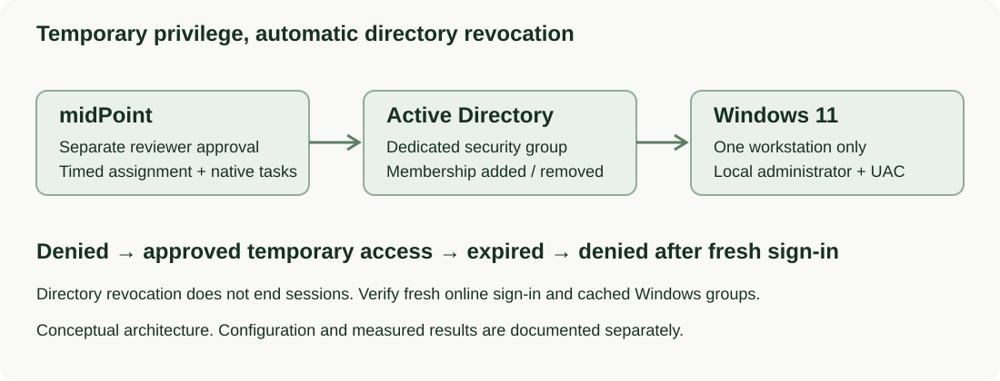

# Just-in-Time Workstation Administration

**✓ Verified** · [CyberAndChill Portfolio](../../README.md)

## What I built

Implemented native approval and a timed midPoint role that grants local administrator access through a dedicated AD group on one Windows workstation.

## Why it matters

Reduce standing administrator privileges while showing the difference between directory revocation and Windows session lifetime.

## Architecture

## Rebuild it yourself

[**Follow the manual GUI walkthrough →**](GUIDE.md)

The guide gives numbered GUI clicks, settings, useful original screenshots and expected results. An extended technical reference is available when needed.

## Result

Verified the full denied → approved temporary access → automatic AD revocation → fresh-sign-in denial cycle. The role had a 15-minute validity window; membership removal was first observed 47.204 seconds after expiry. AD revocation left the Windows session active. A client restart was required to clear stale group information before the final online sign-in check. Native processing resumed after an application restart.

**Technologies demonstrated:** midPoint, Active Directory, Windows 11 Pro, Native approvals, Assignment validity, Scheduled reconciliation

Technical evidence, validation and troubleshooting

**Checks:** 8/8 passed in the recorded implementation. Original evidence is historical, not a new health check.

**Evidence:** A selection of original screenshots is included in the manual walkthrough.

**Limitations:** The 15-minute validity window is not a hard session cutoff. Scheduled processing adds delay, and Windows can retain stale groups across sign-out; the final client test required a restart. Full manual replay and an outage spanning expiry were not tested.

[Extended technical reference](REFERENCE.md)

[Additional notes](NOTES.md). This README is generated by `tools/render.py`.
