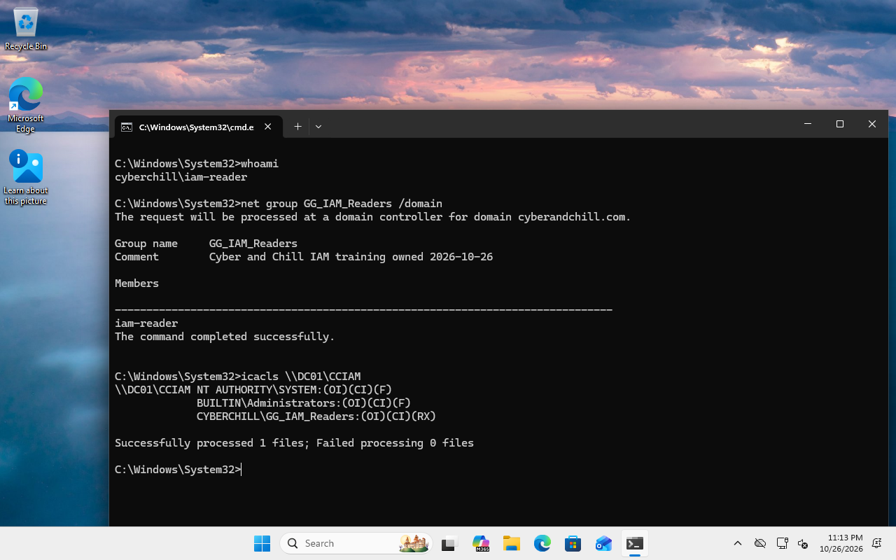
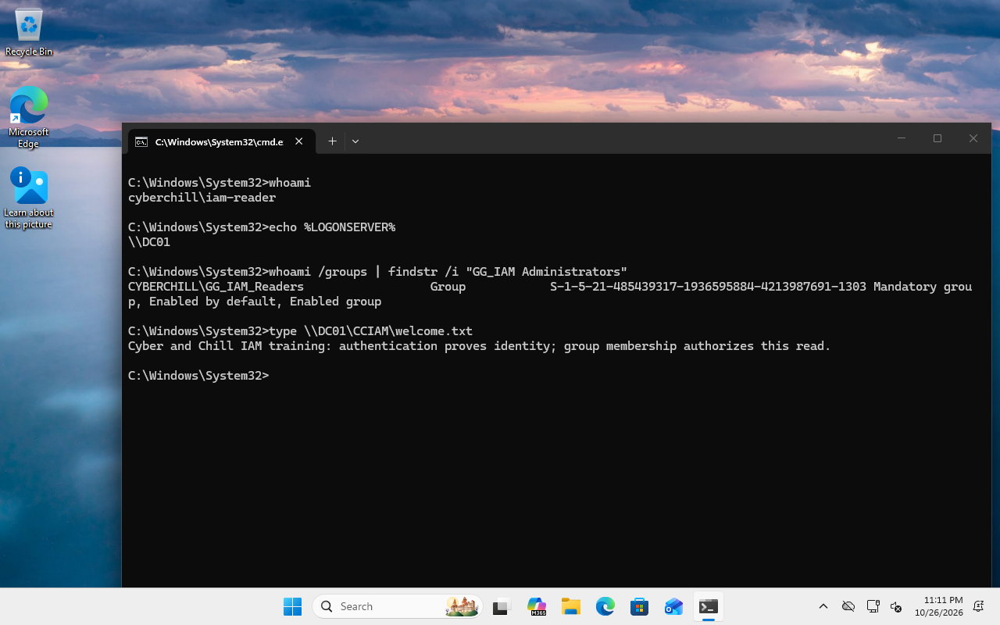
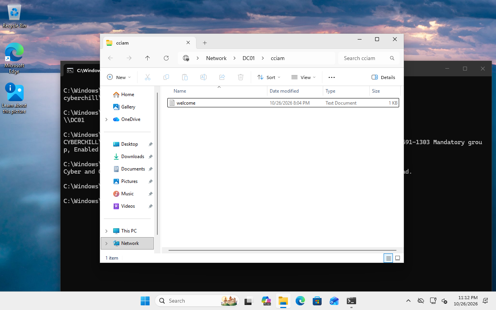
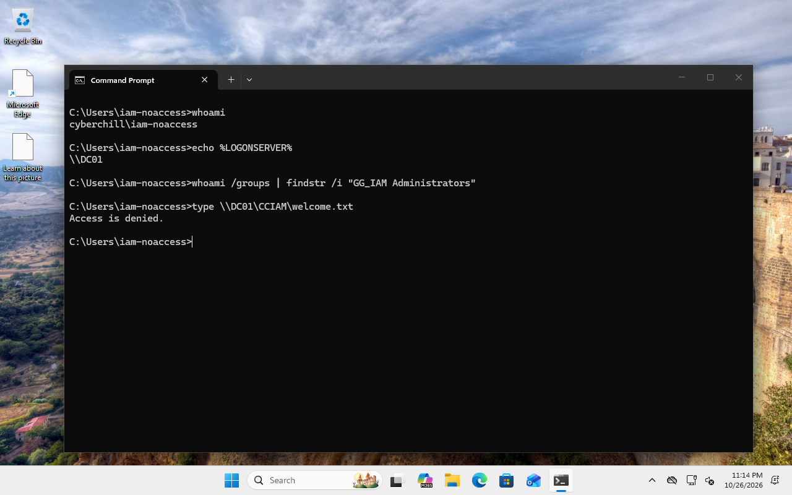
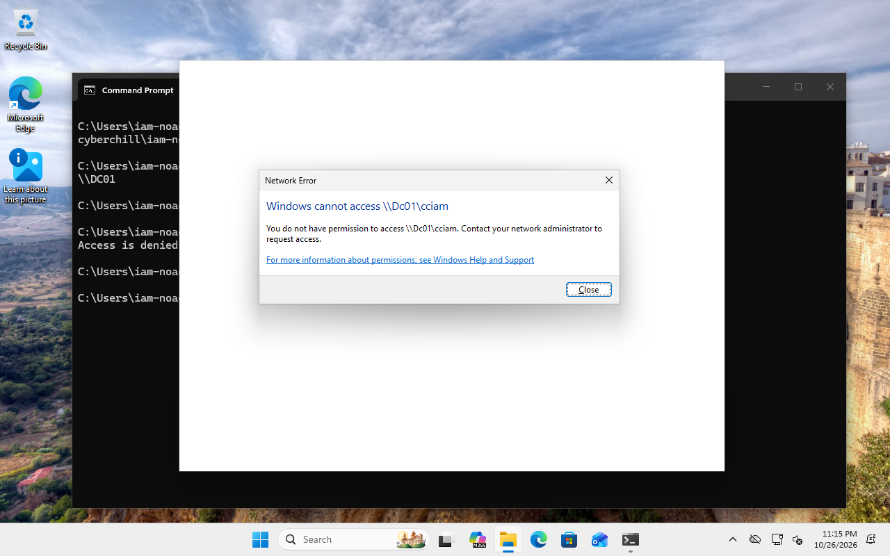

# Authentication vs Authorization — Manual Setup Guide

**Goal:** Sign in to a domain-joined Windows client with two standard users, then prove that only the member of an AD security group can open one protected folder.

**Recorded result:** Both users signed in. `iam-reader` listed the folder and read its file; `iam-noaccess` received **Access Denied**. The reader could not write.

**Procedure status:** Configuration was automated. Native Windows sign-in, Command Prompt and File Explorer verification used automated GUI interaction. The conventional configuration clicks below are derived from the recorded settings; a complete independent manual replay was not performed. The five retained screenshots show genuine verification, not account-creation or permission-edit dialogs. Missing setup screenshots have not been reconstructed.

## Prerequisites

- Complete the [Active Directory setup](../day-01/GUIDE.md), or use an existing working AD domain and joined Windows 11 Pro client. Entra synchronization and the other portfolio projects are not required.
- The recorded environment used **Windows Server 2022 Standard Evaluation, build 20348**, and **Windows 11 Pro, build 26300**. Use valid evaluation/licensing rights. Menu labels can vary by Windows build.
- The existing server and client each had two CPU cores, with 6 GB and 4 GB RAM respectively. This exercise adds accounts, a security group and a small folder; it does not require rebuilding either machine.
- Use an authorized domain administrator to create the dedicated directory objects, and a server administrator to configure the folder/share. Use the standard users for the access tests.
- The client must resolve and reach its controller, have a working domain trust, and reach the server on SMB TCP 445. Keep the exercise on your existing lab network.
- `CyberAndChill.com`, `CYBERCHILL`, `DC01`, `CC-WIN11`, the usernames and paths below are **actual synthetic Cyber and Chill lab values**. Substitute your own domain, NetBIOS name and machine names when reproducing elsewhere. No public DNS changes are needed.
- Verify that the proposed names, folder and share are unused. Preserve existing accounts, groups, permissions, applications and any synchronization scope. Choose separate strong passwords for the two training accounts and enter them privately. The recorded isolated run reused an approved private training credential; its value is not distributed.

## Step 1 — Confirm the domain connection

1. On the server open **Server Manager → Tools → Active Directory Users and Computers**. Expand **CyberAndChill.com → CyberAndChill**.
2. On the client press **Win+R**, enter `sysdm.cpl`, and open **Computer Name**. Confirm the computer is joined to `CyberAndChill.com`.
3. On the client open **Windows Terminal (Admin) → Windows PowerShell** and run `Test-ComputerSecureChannel`. Expect `True`.
4. Run `Resolve-DnsName DC01.cyberandchill.com` and `Test-NetConnection DC01 -Port 445`. Confirm the intended controller and `TcpTestSucceeded : True`.
5. If any check fails, diagnose DNS, time, connectivity and domain trust before changing accounts or permissions. Do not rejoin or reset an established machine simply to repeat this exercise.

**Expected / verify:** The existing client is joined and can reach its controller and SMB service. The [recorded functional summary](evidence/results.json) includes the successful final secure-channel check. No prerequisite-settings GUI screenshot was retained.

## Step 2 — Create two standard users

1. In **Active Directory Users and Computers**, right-click **CyberAndChill → New → Organizational Unit**. Name it **IAMTraining** and leave **Protect container from accidental deletion** checked.
2. Right-click **IAMTraining → New → User**. Set the full name and user logon name to **iam-reader**. Confirm the UPN suffix is `cyberandchill.com`, then click **Next**.
3. Enter the account's private training password. For this isolated exercise, clear **User must change password at next logon** and leave **Password never expires** unchecked. Finish the wizard.
4. Repeat for **iam-noaccess** and `iam-noaccess@cyberandchill.com`.
5. Open each user's **Properties → Account** and confirm the account is enabled. Under **Member Of**, retain the ordinary **Domain Users** membership; grant neither account an administrator role.

**Expected / verify:** Two dedicated, enabled standard users exist. The later [reader session](screenshots/reader-session.png) and [nonmember session](screenshots/nonmember-session.png) identify each actual signed-in user. No account-creation GUI screenshot was retained. If your environment has selected synchronization OUs, keep this new OU outside that selection unless synchronization is separately intended.

## Step 3 — Create the access group

1. Right-click **IAMTraining → New → Group**.
2. Enter **GG_IAM_Readers**, choose **Global** scope and **Security** type, then click **OK**.
3. Open **GG_IAM_Readers → Properties → Members → Add**.
4. Enter `iam-reader`, select **Check Names → OK → Apply**.
5. Reopen **Members**. Confirm that `iam-reader` is the only member; leave `iam-noaccess` out.

*Native verification captured 2026-10-27 at 03:13:18 UTC (October 26 locally). `net group` reports only `iam-reader`; `icacls` shows the resulting group grant. This is result evidence, not a capture of the configuration dialogs.*

**Expected / verify:** Only the reader belongs to the Global Security group. The membership is the intended difference between the users' resource access.

## Step 4 — Protect and share one folder

1. On DC01 open **File Explorer → This PC → Local Disk (C:)**. Create `C:\CyberChillIAM\Protected`. Inside it, create a harmless text document named `welcome.txt`; enable **View → Show → File name extensions** if needed to avoid `welcome.txt.txt`.
2. Right-click **Protected → Properties → Security → Advanced → Disable inheritance**. For this new training folder only, choose **Remove all inherited permissions from this object**.
3. Use **Add → Select a principal** to add **SYSTEM** and **Administrators**, each with **Full control**, applying to **This folder, subfolders and files**. Retain these administrative recovery permissions.
4. Add **CYBERCHILL\GG_IAM_Readers** with **Read & execute**, **List folder contents** and **Read**, applying to **This folder, subfolders and files**. Remove any remaining broad Users/Everyone entries on this training folder. Do not add either individual training user and do not add an explicit deny.
5. Select **Properties → Sharing → Advanced Sharing → Share this folder**. Set the share name to **CCIAM**.
6. Select **Permissions**. Remove the default **Everyone** entry if present. Add **Authenticated Users** with **Read** only, then apply both the share and security settings.
7. Compare the final **Security** entries with the [native permission result](screenshots/group-permissions.png) above: SYSTEM and Administrators have full control; the reader group has read/execute. Under **Sharing**, confirm the network path is `\\DC01\CCIAM`.

**Expected / verify:** The share points to the protected folder. SMB share permissions admit authenticated reads; NTFS allows those reads only for the group member. Both permission layers must allow an operation. Administrator recovery permissions on the local folder do not grant the standard users access. The [reference](REFERENCE.md#permission-model) explains the two layers. No permission-edit dialog screenshot was retained.

## Step 5 — Verify the authorized user

1. On CC-WIN11 sign out of any current session. Select **Other user**, enter `CYBERCHILL\iam-reader`, and enter its password privately.
2. Open **Command Prompt**. Run `whoami` and `echo %LOGONSERVER%`; confirm the intended reader and controller.
3. Run `whoami /groups`. Confirm **GG_IAM_Readers** is present and the account has no administrator membership.
4. Open **File Explorer**, enter `\\DC01\CCIAM` in the address bar, and open `welcome.txt`. For a simple command-line content check, run `type \\DC01\CCIAM\welcome.txt`.

*Native capture: 2026-10-27 03:11:47 UTC. The actual reader session shows the access group and successfully reads the protected file.*

*Native capture: 2026-10-27 03:12:44 UTC. Explorer lists the file in the protected share. Successful Windows sign-in alone was not used as evidence of folder access.*

**Expected / verify:** Sign-in succeeds, the folder opens, and its file can be read. The recorded checks also attempted a write-open without changing content and confirmed denial; this is a read-only grant.

## Step 6 — Verify the nonmember

1. Sign out completely. Select **Other user** and sign in as `CYBERCHILL\iam-noaccess`; do not reuse the reader's session or saved SMB credentials.
2. In **Command Prompt**, run `whoami`, `echo %LOGONSERVER%`, and `whoami /groups`. Confirm the second identity, the intended controller, and absence of **GG_IAM_Readers** and administrator membership.
3. In **File Explorer**, enter the same exact `\\DC01\CCIAM` path. Expect **You do not have permission to access** the share. Do not supply alternate administrator or reader credentials.
4. In Command Prompt run `type \\DC01\CCIAM\welcome.txt`. Expect **Access is denied**.

*Native capture: 2026-10-27 03:15:01 UTC. The second user's identity and controller are visible; the same file read is denied.*

*Native capture: 2026-10-27 03:15:15 UTC. Explorer reports a permission denial, rather than a missing server or bad network path.*

**Expected / verify:** The second account authenticates successfully but cannot open the resource. Authentication proves identity; authorization evaluates that identity's resource permissions.

## Verification

| Check | Recorded outcome |
|---|---|
| Both standard users sign in to Windows | Passed |
| Only iam-reader belongs to GG_IAM_Readers | Passed |
| Reader lists the folder and reads its file | Allowed |
| Nonmember opens the same folder/file | Access denied |
| Reader opens the file for write without modifying it | Denied |
| Share, membership and ACL survive the controller restart | Passed |

The project publishes [12 functional checks and their evidence](project.json), with a [recorded result summary](evidence/results.json). These are historical lab results, not a claim that the environment is currently online. If you change group membership later, sign out and back in and verify the actual token before repeating access tests.

Full manual configuration replay, client restart and group removal/re-add were not tested. Screenshot capture timestamps come from the capture system; early client UTC values differed and remain visible in the original evidence. No authentication-protocol-specific claim is made. See [provenance](evidence/image-provenance.json) and the [extended reference](REFERENCE.md).
