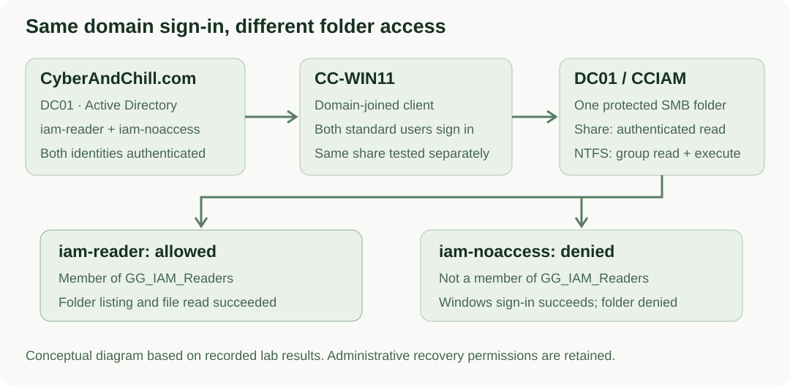

# Authentication vs Authorization with Active Directory

**✓ Verified** · [CyberAndChill Portfolio](../../README.md)

## What I built

Created two standard domain users and one protected SMB folder, with read access granted through an AD security group and enforced by NTFS permissions.

## Why it matters

Successful sign-in establishes identity; group-based authorization limits which resources that identity can access.

## Architecture

## Rebuild it yourself

[**Follow the manual GUI walkthrough →**](GUIDE.md)

The guide gives numbered GUI clicks, settings, useful original screenshots and expected results. An extended technical reference is available when needed.

## Result

Both standard users signed in to Windows. The group member listed the folder and read its file; the nonmember received Access Denied. The reader could not write. Group membership, permissions and share access were verified again after a controller restart.

**Technologies demonstrated:** Active Directory, Windows Server 2022, Windows 11 Pro, SMB, NTFS permissions

Technical evidence, validation and troubleshooting

**Checks:** 12/12 passed in the recorded implementation. Original evidence is historical, not a new health check.

**Evidence:** A selection of original screenshots is included in the manual walkthrough.

**Limitations:** Recorded synthetic lab results. Desktop tests used automated GUI interaction; the complete manual configuration sequence was not independently replayed. Account-creation and permission-edit GUI screenshots were not retained.

[Extended technical reference](REFERENCE.md)

[Additional notes](NOTES.md). This README is generated by `tools/render.py`.
